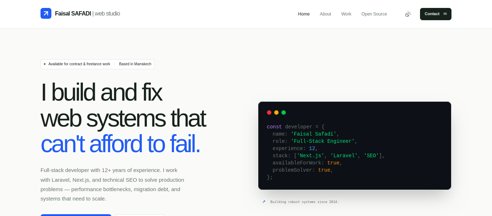

# Next.js + Velite Portfolio Template

A modern, SEO-optimized portfolio template for developers, freelancers, and studios. Built with **Next.js 16 (App Router)**, **Velite** (for type-safe Markdown content), **Tailwind CSS**, and **Framer Motion**.

> 🔗 **Live Demo**: [https://faisalsafadi.vercel.app](https://faisalsafadi.vercel.app)

---

## 📑 Table of Contents

- [✨ Features](#-features)
- [🚀 Quick Start](#-quick-start)
- [✍️ How to Add Content](#️-how-to-add-content)
  - [Adding a Work Project](#adding-a-work-project)
  - [Adding an Open Source Tool](#adding-an-open-source-tool)
- [🎨 Customization](#-customization)
- [🚢 Deployment](#-deployment)

---

## ✨ Features

- **Content as Data**: Manage your projects and case studies via simple Markdown files using [Velite](https://velite.js.org/).
- **SEO First**: Dynamically generated sitemaps, Open Graph images (`/api/og`), JSON-LD structured data (Person, CreativeWork, Breadcrumbs), and canonical URLs.
- **Blazing Fast**: Built on Next.js 16 with Turbopack.
- **Beautiful Animations**: Smooth scroll reveals and hover effects powered by Framer Motion.
- **Fully Responsive**: Mobile-first design with a clean, accessible UI.
- **Dark Mode**: Built-in theme toggler (local storage based).

---

## 🚀 Quick Start

### 1. Clone the repository

    git clone https://github.com/faisalsafadi/seo-nextjs-starter.git
    cd seo-nextjs-starter

### 2. Install dependencies

This project uses pnpm (recommended).

    pnpm install

### 3. Set up environment variables

Copy the example file and update it with your details:

    cp .env.example .env.local

Open `.env.local` and set your `NEXT_PUBLIC_URL` and `NEXT_PUBLIC_SITE_NAME`.

### 4. Run the development server

    pnpm dev

---

## ✍️ How to Add Content

This template uses Velite to generate pages from Markdown files.

### Adding a Work Project

Create a new `.md` file in `src/content/work/` (e.g., `my-project.md`):

    ---
    title: "My Awesome Project"
    description: "A short summary of what this project does."
    date: "2026-01-01"
    category: "Full-Stack"
    technologies: ["Next.js", "TypeScript", "PostgreSQL"]
    featured: true
    order: 1
    coverImage: "/images/work/my-project.jpg"
    ---

    ## The Context
    Write your case study content here using Markdown.

    ## The Solution
    Explain your technical approach...

### Adding an Open Source Tool

Create a new `.md` file in `src/content/open-source/` (e.g., `my-tool.md`):

    ---
    title: "My Open Source Tool"
    description: "A CLI tool that does X."
    date: "2026-02-15"
    category: "Developer Tools"
    technologies: ["Node.js", "CLI"]
    githubURL: "https://github.com/yourusername/my-tool"
    ---

    ## About
    Write the documentation for your open source project here.

---

## 🎨 Customization

- **Site Config**: Update `src/config.ts` to change your name, contact email, and social links.
- **Styles**: Global styles and CSS variables are located in `src/app/globals.css`. The color palette is controlled by CSS variables (supports light/dark mode).
- **Hero Section**: Edit `src/app/page.tsx` to change the text in the hero section.
- **Screenshot**: Replace `public/images/screenshot.png` with your own preview image

---

## 🚢 Deployment

The easiest way to deploy this template is via Vercel.

1. Push your code to a GitHub repository.
2. Import the project into Vercel.
3. Add your environment variables (`NEXT_PUBLIC_URL`, etc.).
4. Vercel will automatically build and deploy your site.

**Important for SEO**: Once your site is fully customized and ready, change `NEXT_PUBLIC_INDEXABLE` to `"true"` in your Vercel environment variables to allow search engines to index it.

## 🔗 Links

- **Live Demo**: [https://faisalsafadi.vercel.app/](https://faisalsafadi.vercel.app/)
- **GitHub Repository**: [https://github.com/faisalsafadi/seo-nextjs-starter](https://github.com/faisalsafadi/seo-nextjs-starter)
- **Documentation**: [Velite docs](https://velite.js.org/)